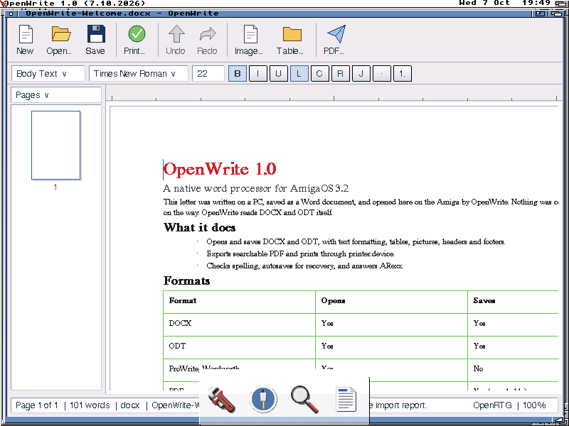

# GFOffice

This is the GFOffice Suite: native office apps for AmigaOS 3.2, all sharing
one document library, **libowf**. Its apps keep their GFOpen names:

- **GFOpenWrite**, the word processor (released, below);
- **GFOpenCalc**, the spreadsheet (an early Amiga application with its formula
  engine and portable core);
- **GFOpenPresentation**, the early slide viewer and editor;
- **GFOpenPublisher**, a desktop-publishing model and Microsoft Publisher reader
  without an application yet;
- **GFOpenBase**, the database, currently at the design stage.

The suite aims at the features of Apache OpenOffice's apps. It is written from
the file formats' specifications and our own code, never from OpenOffice's
or LibreOffice's. The designs are in `docs/gfoffice/`.

This repository was called `openamigawrite` until 25 October 2026. GitHub
redirects the old name.

# GFOpenWrite

GFOpenWrite 2.0.25 is a native word processor for AmigaOS 3.2.



*GFOpenWrite on AmigaOS 3.2.3 (an AmiCradle instance with GFOpenRTG and the Open look), opening a DOCX written in Word.*

It is a small 68040 C application with no FPU requirement and no browser,
Unix GUI or JavaScript runtime dependency. The document/file layer is the
separate C library **libowf**, and **C:OWConvert** converts from the Shell.

GFOpenWrite includes:

- caret/selection editing with bounded grouped undo/redo;
- bold, italic, underline, font family and point size;
- paragraph styles, alignment, indents, spacing and line spacing;
- bullets and numbering;
- native tables with row/column editing, Tab/Shift-Tab navigation, and
  undoable cell/row/table fills and borders that round-trip through DOCX/ODT;
- embedded inline images, decoded for display through Amiga datatypes;
- floating images with square text wrapping, and editable anchored text boxes,
  through GFOpenLayout's frame placement and hit testing; click and drag a
  floating image to move it, drag a corner handle to resize it, or use
  **Layout / Frame...** for exact undoable page position, size and wrap controls
  (the same command edits the text box containing the caret); arrow keys nudge
  a selected image 1 mm, Shift+arrow 5 mm, Delete removes it, and Escape returns
  to text editing;
- headers and footers in the document model and rendered pages;
- clipboard.device cut/copy/paste using FTXT-compatible text;
- Find, Find Again, Find Previous, Replace and Replace All;
- automatic pagination and explicit page breaks;
- undoable whole-document newspaper columns (1-16, with an editable gap),
  plus imported mixed-column sections with continuous, new-page, odd-page and
  even-page boundaries; paginated, rendered and hit-tested by GFOpenLayout and
  preserved in DOCX/ODT;
- A4/Letter page setup, portrait/landscape and margins;
- multi-page navigation, scrolling, 100%, Fit Page and Fit Width views;
- spelling against the bundled en_GB dictionary plus a user dictionary;
- 60-second recovery autosave and interrupted-session recovery;
- an ARexx port for scripted open/save/export/print/text/search/edit commands;
- DOCX and ODT formatted import/export, including simple tables and inline images;
- RTF import and export with text and basic character, paragraph and page formatting;
- searchable direct PDF export;
- Print: with GFOpenPrint on the disk, the document as laid out (a PDF, as Export PDF makes it) in GFOpenPrint's Print window, for an IPP printer or a saved PDF; without GFOpenPrint, its text through printer.device.

GFOpenWrite also opens ProWrite, Final Writer/Final Copy-family SWRT documents,
Wordworth, IFF FTXT, ANSI text and plain text. Import reports name
approximations and unsupported material instead of silently pretending it was
preserved.

The current native architecture is documented in
`docs/architecture/NATIVE_CORE.md`; the interaction design is in
`docs/UX_DESIGN.md`; the format matrix is in `docs/FORMATS.md`. How Writer
uses GFOpenLayout now, and the next shared layout services, is in
`docs/architecture/GFOPENLAYOUT_WRITER.md`.

## GFOpen family integration

- **GFOpenGadTools/GFOpenLook**: application UI and themes.
- **GFOpenRTG**: accelerated document-canvas path where available.
- **GFOpenDatatypes / Amiga datatypes**: embedded image/media decoding.
- **GFOpenPrint / printer.device**: print and output path.

The same editor remains usable without accelerated RTG hardware; AGA/planar
rendering is a supported fallback path.

## Requirements

GFOpenWrite:

- AmigaOS 3.2 or later;
- a 68040 (the builds are 68040 code);
- no FPU required;
- small documents are intended to remain usable around 8 MB Fast RAM;
- 16-32 MB Fast RAM is the comfortable target for ordinary work.

OWConvert is 68040 code too and does not require the GFOpenWrite GUI.

## Building and testing

On Linux, with Python 3 and zlib:

```
make
make core-test
make spell-test
make test
make check
make libc-test
```

`make libc-test` checks the libraries' own printf, sscanf, strtol and case calls
against the PC's C library. `make test` and `make check` include the
workbook tests (`make book-test`, `make book-check`): Excel 97-2003 files
read into the spreadsheet's model, and saved as CSV
(`tests/book/test_books.py`).
XLSX, ODS, flat ODS and CSV are read and written by the same tests
(`tests/book/test_xml_books.py`, `tests/book/test_bookfmt.c`): files other
programs wrote, packages written by hand from the specifications, round
trips between the formats, and damaged and cut-short files.

They include the formula engine's tests too (`make calc-test`, `make
calc-check`): GFOpenCalc's engine in `libowf/calc` (calls in
`libowf/include/owf_calc.h`; `docs/CALC_ENGINE.md`), with its functions
checked one by one and against the results saved in the workbook fixtures.

Pages are laid out by GFOpenLayout (DalsinAI/gfopenlayout 0.2 or later).
With it checked out beside this repository, or `OPENLAYOUT_SRC` pointing at
it, `make layout-test` lays out a built document and the samples into pages
and checks the caret and pointer mapping; `make layout-check` runs the same
under the address and undefined-behaviour sanitizers.

For AmigaOS 3.x with the os32-gcc16 stove (GFOpenAmigaGCC 16; set `OS32_GCC16`
if it is not in `~/AmiCradle/stoves/os32-gcc16`):

```
./build-os3.sh                 # libowf linked into each program
OWF=library ./build-os3.sh     # each on its library: GFOpenWrite on owfwrite.library,
                               # GFOpenCalc on owfcalc.library, OWConvert on all four
```

This builds:

```
build/os3/GFOpenWrite
build/os3/OWConvert
build/os3/library/owfwrite.library   (OWF=library: GFOffice's four libraries,
build/os3/library/owfcalc.library     docs/suite/owf-libraries.md)
build/os3/library/owfpub.library
build/os3/library/owfpresent.library
build/os3/library/owf.library        (OWF=library)
build/os3/library/tests/OWFLibsTest  (OWF=library)
build/os3/library/tests/OWFLibTest   (OWF=library)
```

ODT and DOCX deflate and inflate through z.library, ours from
amicradle-guest (`libraries/openzlib`), opened the first time a document
needs it. There is no zlib source in the Amiga build. z.library is no
longer needed to read: without it in LIBS:, libowf inflates zip packages
(ODT, DOCX, XLSX, ODS) with its own inflater, written from RFC 1951
(`libowf/src/owf_inflate.c`, more slowly than z.library; tested by `make
inflate-test` and `make inflate-check`, part of `make test` and `make
check`). Files are then written stored, which every reader accepts.

### GFOffice's libraries

libowf is split along the programs' lines into four shared Amiga libraries
(`docs/suite/owf-libraries.md`), each version 3.0:

| Library | For | Holds |
| --- | --- | --- |
| `owfwrite.library` | GFOpenWrite | documents and their formats, PDF out |
| `owfcalc.library` | GFOpenCalc | workbooks, their formats, charts, the formula engine |
| `owfpub.library` | GFOpenPublisher | the .pub reader |
| `owfpresent.library` | GFOpenPresentation | decks, ODP, the page PDF writer |

`./build-library.sh [OUT_DIR]` builds them: libowf once into an archive,
then each library from its own file in `libowf/library` (`<name>_library.c`,
its calls in `<name>_calls.h`, which `scripts/gen-lib-calls.py` makes from
its `<name>_lib.sfd`), so each takes only the files its calls reach. The
first 17 calls (memory, reports, `owf_file_kind`, zip and inflate,
`owf_struct_size`) are the same, at the same offsets, in all four. Each has
its own memory pool: what a library allocates goes back through that
library's `owf_free`.

A program (or one file of it: one library per file) names its library with
`OWF_USE_WRITE_LIBRARY`, `OWF_USE_CALC_LIBRARY`, `OWF_USE_PUB_LIBRARY` or
`OWF_USE_PRESENT_LIBRARY`, includes `owf.h` and `owf_open.h`, and calls
`owf_open()`, which opens it and checks the sizes of the structures that
library shares. `OWFLibsTest` on an Amiga opens the four and checks each
(`ONLY=write`, `calc`, `pub` or `present` for one alone), from two tasks at
once; `make sfd-check` checks the SFDs, the generated glue and the SDK.

owf.library 2.5, below, is still built beside them until GFOpenUp ships the
four; then it goes.

### owf.library

`owf.library` is libowf as a shared Amiga library: every program that reads
or writes documents (GFOpenWrite, OWConvert, and the spreadsheet and
presentation programs to come) opens one copy instead of linking its own.
`./build-library.sh [OUT_DIR]` builds it on its own, with no C library: its
memory comes from one Exec pool, and it carries its own string, printf and
number calls (`libowf/library`). The calls are described in
`libowf/library/owf_lib.sfd`; `scripts/gen-sdk.sh` makes its headers in
`libowf/library/sdk` with GFOpenNDK's ndkgen.

A program uses it by defining `OWF_USE_LIBRARY`, including `owf.h` and
`owf_open.h`, and calling `owf_open()` before anything else. Document memory
a program changes itself comes from `owf_malloc` and `owf_free`, so the
library and the program agree on whose memory it is.

`OWFLibTest SAMPLES=<dir>` on an Amiga checks the library: the formats, a
round trip through ODT, DOCX, HTML, PDF and text in T:, the two sample
documents, and the same checks from a second process at once.

**Version 2** (`owf.library 2.0`) keeps version 1's 29 calls where they were
and adds 58 after them (offsets -204 to -546): the workbooks (`owf.h`'s
"Workbooks" section: XLS, XLSX, ODS, flat ODS and CSV), the formula engine
(`owf_calc.h`), `owf_file_kind` (which program a file is for) and
`owf_struct_size`, zip reading and libowf's own inflate (`owf_zip.h`), and
the .pub reader (`owf_pub.h`). A double goes in two data registers, high
word first. Programs index the library's arrays themselves, so the
structures' sizes are part of its ABI: `owf_open()` opens version 2 and
refuses a library whose sizes differ from the program's. The workbook and
engine code brings doubles into the library, which links no C library:
it carries its own soft double arithmetic (`owf_softdouble.c`, from
amicradle-guest) and maths and `strtod` (`owf_libm.c`), and opens no
mathieee library, so it needs no FPU and never touches a caller's FPCR.
`make library-test` (part of `make test`) checks them against the PC's,
runs the engine's own tests on them, runs OWFLibTest's version-2 checks
with libowf linked in, and checks the SFD against the headers, the glue's
registers and the SDK (`tests/library/check_sfd.py`). OWFLibTest takes
`FIXTURES=<dir>` too (build-library.sh puts `samples/` and `fixtures/`
beside it). The deck calls (GFOpenPresentation) come in a later version.

## 1.0 validation

The 1.0 release gate includes:

- native editor/core tests;
- spelling tests;
- AddressSanitizer and UndefinedBehaviorSanitizer runs;
- the libowf normal and sanitizer corruption/cut-short corpus;
- m68k AmigaOS cross-build;
- real AmigaOS 3.2.3/GFOpenRTG bench validation.

## GFOpenCalc

GFOpenCalc is the spreadsheet of the GFOffice Suite, beside GFOpenWrite in this
repository for now. Its portable core is `src/calc` (`include/opencalc_core.h`):
the view, the selection, keys as Excel and LibreOffice have them, editing,
fill, insert and delete, the clipboard, styles, bounded undo and the grid as a
list of things to draw. Its reusable core also stably sorts a selected range
by up to eight native-UI keys (the API accepts any unique selected columns),
each ascending or descending, with an optional header row; formulas, direct
formatting and comments move with their rows and the operation is one undo
step. Merge and unmerge are native editing commands too, with a warning
before a merge would discard values outside the upper-left cell. Cell comments
can be added, edited and removed with undo, using the same model that imports,
renders and exports them. Worksheet Find wraps through formatted cell values;
the reusable core can also search backwards, case-sensitively and through
formula-bar input. It is tested on the PC with `make calc-test` and
`make calc-check` (both part of `make test` and `make check`). The Amiga
window is `app/opencalc.c`, built by `build-os3.sh` with libowf linked in
(OWF=linked). Workbooks are libowf's `owf_book`; their formulas are worked out
by the engine in `libowf/include/owf_calc.h`. GFOpenCalc 0.1.44 can turn a
selected table into a column, bar, line, area, pie or scatter chart from its
native Insert menu. The reusable core builds series/category references and
cached values, supports clustered, stacked and percent grouping, keeps charts
live as cells change, and creates/deletes them as undoable whole-workbook
steps. Authored charts can be selected, dragged, printed and saved through
XLSX and ODS. Drawings containing pictures or shapes are refused rather than
destructively rewritten. It can also deep-copy
a sheet's cells, formats, comments, rules, filters, local names, cursor and
supported charts, with independent chart package parts supplied by reusable
`owfcalc.library` 3.4. Duplication is undoable and round-trips through XLSX/ODS;
drawings with unsupported pictures or shapes are refused rather than silently
discarded. It can reorder, hide and show sheets while preserving each sheet's content, cursor and local
name scopes; these operations are undoable and persist through XLSX/ODS. Its
reusable sheet API keeps formula-engine indexes coherent, while the native
Sheet menu exposes the commands. It can create,
update, delete and navigate workbook and sheet-local named ranges. The reusable
API accepts arbitrary name formulas or defines the current selection, rebuilds
dependent formulas immediately, and makes each change undoable; the native
Sheet menu exposes selection-based definition and scoped deletion, and the
name box and Go To resolve local names before workbook names. Names round-trip
through XLSX and ODS. GFOpenCalc can also add layered
cell-comparison, formula and two/three-colour-scale conditional formats, clear
them from selected cells without losing their surrounding ranges, render them
immediately, undo them and save them through XLSX/ODS. It can also author,
replace and clear list, whole-number, decimal, date, time, text-length and
custom-formula validation over selected cells. Existing surrounding rules are
preserved when a smaller selection replaces part of one, and authored rules
are enforced immediately and saved to XLSX/ODS. It can also create and
remove an AutoFilter, filter a table by any distinct displayed value from a
heading's arrow, combine exact-value conditions across columns, clear one
column or show all rows, and apply one or two same-column Standard Filter
comparisons (`=`, `<>`, `<`, `<=`, `>` or `>=`) joined by AND or OR. Equality
supports Excel wildcards (`*`, `?`, with `~` to quote them). It can also select
nonblank cells or the top/bottom
1–500 numeric values or 1–100 percent, including ties at the boundary.
Conditions across columns combine with AND, numeric ordering compares
numerically, and a heading lists the values still possible under the other
columns. The portable API writes the same filter range, conditions and hidden
rows to XLSX and ODS. It also exports every
visible sheet as a searchable, paginated A4 PDF, fitted one page wide by
default, from the same reusable draw list as the window; it keeps cell and
conditional formatting, merged cells, borders, frozen panes and imported
charts. Print passes that PDF to GFOpenPrint. The renderer is the portable
`oc_core_pdf` API, and the page PDF calls are also in `owfcalc.library` 3.3.

## GFOpenPresentation

GFOpenPresentation is the GFOffice Suite's slide program, beside GFOpenWrite and
GFOpenCalc here for now (`docs/gfoffice/Design-OpenPresentation.md`). Phase
P1 is in: the deck model in libowf (`libowf/include/owf_deck.h`), ODP and
flat ODP opened and saved, and a deck's PDF, its slides laid out by
GFOpenLayout in its portable core (`src/deck`, `include/openpresentation_core.h`)
and drawn by the page PDF writer (`libowf/include/owf_pdf.h`).
`OWConvert Talk.odp Talk.pdf` makes one. `make deck-test` and `make
deck-check` (part of `make test` and `make check`) test them; with
GFOpenLayout found (`OPENLAYOUT_SRC`) the PDF tests run too.

Phase P2 has PPTX opened (`libowf/src/in_pptx.c`; `make deck-test` runs
`tests/deck/test_pptx.py` on decks made with python-pptx) and the program,
`app/openpresent.c` (GFOpenPresentation 0.3), built by `build-os3.sh`: it opens
ODP and PPTX, shows the slide at the window's size with the slide sorter
beside it, and saves ODP (a PPTX is saved as ODP, through Save As). The first
part of P3 is in too: click in a slide's text box and type (Return, Backspace,
Del, the arrow keys; Esc stops), with undo and redo
(`src/deck/opr_edit.c`, tested by `make deck-edit-test` and `make
deck-edit-check`). Click any slide object to select it, drag it to move it,
drag one of its eight handles to resize it, or use the arrow keys to nudge it
one screen pixel (Shift: ten); each completed move or resize is a single
undoable core operation and inherited layout-placeholder geometry becomes an
explicit ODP box. Slide > New Slide, Duplicate Slide, Rename Slide, Delete
Slide, Hide/Show Slide, Move Slide Up and Move Slide Down are undoable through
that same reusable core; duplication uses libowf's deep-copy deck primitive.
F5 starts a borderless full-screen show from the first visible slide and
Shift-F5 from the current slide. The reusable `opr_show` state machine skips
hidden slides, follows automatic timings, loops when asked and handles first,
last, next, previous, numbered and explicit hidden-slide navigation. The
player also has black and white screens. Its public-screen backend plays cut,
ordered crossfade and fade-through-black, directional wipe, push, cover,
uncover, centre split, eight-strip blinds and deterministic dissolve through
off-screen bitmaps, with a cut fallback when memory or frame time is short.
Slide > Slide Transition edits each slide's effect, direction, duration and
automatic advance delay, can apply the settings to every slide, and is one
undoable operation. These settings are saved in ODP and drive the player.
Reusable transition plans and ordered-fade masks sit beside the show state and
are host-tested by `make deck-show-test`. Print hands the slides to GFOpenPrint as a PDF (`C:GFOpenPrint
T:<name>.pdf`), and Export PDF writes one. View > Zoom In and Zoom Out (+
and -) show the slide up to four times the window's fit, with scrollers; the
window's zoom gadget fills the screen. An optional own screen, PPTX saving,
content insertion and the rest of the editor come next.

## Licence

MIT, Copyright (c) 2026 AmiCradle Team (`LICENSE`).

Third-party components and data retain their own licences and notices; see
`THIRD_PARTY.md` and `licenses/`.

If you use or build on this work, we ask, but do not require, that you credit
the AmiCradle Team, for example: "based on GFOpenWrite by the AmiCradle
Team".

## Contributors

GFOpenWrite is created and maintained by
[SacredTrees](https://github.com/SacredTrees), copyright AmiCradle Team.
Everyone whose work it includes is credited in `CONTRIBUTORS.md`.
