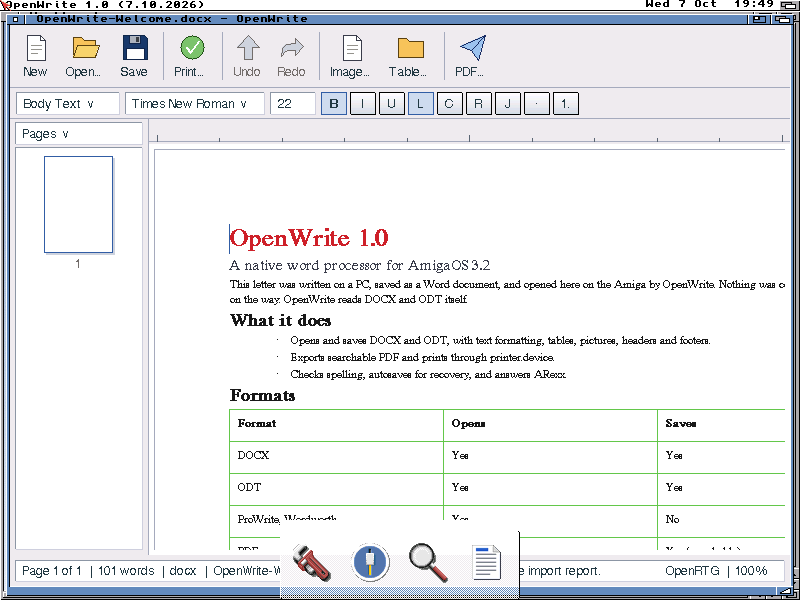
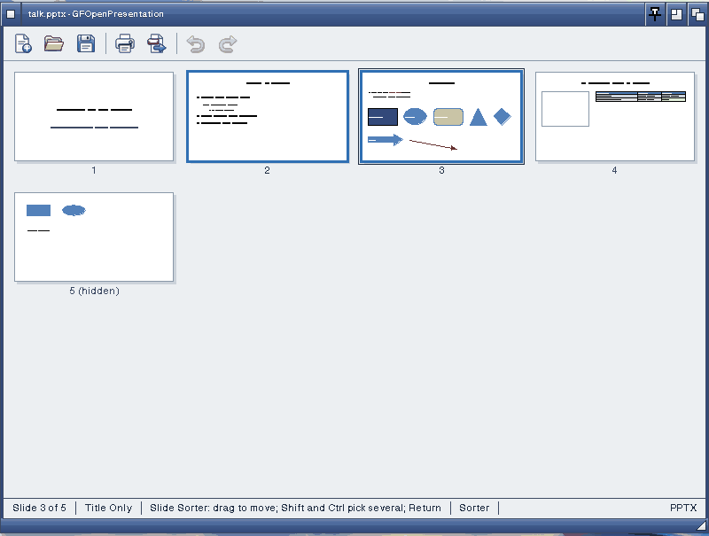

# GFOffice

## A complete, native office suite for the Amiga

GFOffice brings everyday office work back to the Amiga. Seven applications,
written from scratch in C for AmigaOS 3.x, open the documents the rest of the
world sends you, let you edit them properly, and save them so the rest of the
world can read them again.

Word processing, spreadsheets, presentations, desktop publishing, databases,
project planning and diagrams: all native, all fast on a 68040, all sharing
one document engine, and all free and open source under the MIT licence.



*GFOpenWrite on AmigaOS 3.2.3, opening a DOCX document as it was written.*

## Why GFOffice

- **Your files, both ways.** OpenDocument and Microsoft Office formats open
  and save: ODT, DOCX, RTF, XLSX, ODS, CSV, ODP and PPTX. Publisher `.pub`
  files open in GFOpenPressmaster, and older Excel `.xls` workbooks open in
  GFOpenCalc.
- **Built for the Amiga.** Real Amiga windows, menus and gadgets, Amiga
  datatypes for pictures, the clipboard in most applications, and an ARexx
  port in every application for scripting and automation.
- **Light on hardware.** A 68040 is enough, no FPU is needed, and small
  documents are happy in 8 MB of Fast RAM. RTG screens are used when they are
  there, and AGA works too.
- **One engine, shared.** Every application sits on libowf, the suite's
  document library, also available as four shared Amiga libraries
  (`owfwrite`, `owfcalc`, `owfpresent` and `owfpub`), so programs share code
  and memory instead of each carrying its own.
- **PDF from every program.** Every application exports PDF, and GFOpenWrite,
  GFOpenCalc, GFOpenPresentation and GFOpenPressmaster also print through
  GFOpenPrint.
- **Clean room and open.** Written from the published file format
  specifications and real sample files, never from another suite's source.
  MIT licensed.

## The applications

### GFOpenWrite: word processor

A full word processor that keeps up with modern documents: styles, tables,
pictures with text wrap, headers and footers, columns and sections, footnotes,
a linked table of contents, tracked changes and comments, fields, spelling
with an en_GB dictionary, autosave and recovery. Opens and saves DOCX, ODT,
RTF and Markdown, exports HTML and PDF, and opens classic Amiga documents
from ProWrite, Final Writer, Final Copy and Wordworth.

### GFOpenCalc: spreadsheet

A real spreadsheet with a full formula engine: sorting and filtering,
conditional formats with colour scales, data bars and icon sets, validation,
named ranges, Goal Seek, Subtotals, Multiple Operations, Consolidation,
scenarios, pivot tables with drill-down, tracked changes, and live charts with
trendlines, error bars and secondary axes. Opens and saves XLSX, ODS and CSV,
and opens Excel 97-2003 workbooks.

### GFOpenPresentation: slides and slide shows



Build and edit slides with text, pictures, tables, charts and masters, with
solid, gradient and hatched fills and shadows. Rearrange them in the slide
sorter, then present full screen with transitions and timings. Opens and saves
ODP and PPTX.

### GFOpenPressmaster: desktop publishing

Lay out newsletters, flyers and booklets with linked text frames, columns,
text wrap round pictures and shapes, master pages and page numbers, grids and
guides. Mail and catalog merge, built-in templates, and print-ready PDF with
crop marks and bleed. Opens Publisher `.pub` files and saves ODP and PDF.

### GFOpenBase: database

Design tables, keys and relationships, browse and edit in a datasheet, build
queries visually or in SQL, and create forms and grouped, totalled reports
with a print preview. Imports and exports CSV, dBASE, ODS and XLSX, and makes
reports as ODT, DOCX or PDF.

### GFOpenProject: project planner

Plan tasks, milestones and dependencies, see the critical path, and follow the
work in Gantt, Tracking Gantt, Network Diagram and usage views. Assign and
level resources, set baselines, record actuals and track earned value. Reads
and writes Microsoft Project XML and CSV, and reads MPX and GanttProject files.

### GFOpenDiag: diagrams

Flowcharts, UML, network diagrams and mind maps, with connectors that stay
attached, layers, grouping and alignment. It opens and saves `.drawio` files and
exports SVG, PNG, PDF, EPS,
Mermaid, DOT, GraphML and Excalidraw.

## Getting started

1. Download the latest `GFOffice-…-AmigaOS3.zip` from
   [Releases](https://github.com/DalsinAI/gfoffice/releases).
2. Unpack it to a drawer on your hard disk, for example `Work:GFOffice`.
3. Double-click an application to start it, or drop a document on it.

The `library` drawer holds the shared libraries for the library builds; copy
them to `LIBS:` if you use those. GFOpenPrint is needed for printing laid-out
pages, and the ARexx examples are in the `Rexx` drawer.

**Requirements:** AmigaOS 3.2 or later, a 68040 (no FPU needed), 8 MB of Fast
RAM for small documents and 16 to 32 MB for comfortable everyday work.

## Status

Each application is measured against the everyday workflow of the popular
free office suites and their companion tools. The full scorecards are in
[`docs/parity/`](docs/parity/).

| Application | Version | Everyday feature coverage |
| --- | --- | --- |
| GFOpenWrite | 2.0.48 | 85% |
| GFOpenCalc | 0.1.78 | 80% |
| GFOpenPresentation | 0.6.35 | 89% |
| GFOpenPressmaster | 0.3.36 | 71% |
| GFOpenBase | 0.15.0 | 64% |
| GFOpenProject | 0.1.20 | 64% |
| GFOpenDiag | 0.1.0 | 66% to 72% |

GFOpenWrite 2.0.48 is the most complete of the seven and is the one to try
first. GFOpenPresentation 0.6.35 is close behind. GFOpenPressmaster was
called GFOpenPublisher before 16 November 2026.

## Building from source

On Linux, with Python 3 and zlib, the host tools and every unit test:

```
make            # host tools
make test       # all unit tests
make check      # the same under AddressSanitizer and UBSan
```

For AmigaOS, with the os32-gcc16 cross compiler (GFOpenAmigaGCC 16) and
[GFOpenLayout](https://github.com/DalsinAI/gfopenlayout) checked out beside
this repository:

```
./build-os3.sh                 # each program with libowf linked in
OWF=library ./build-os3.sh     # each program on its shared library
./build-library.sh [OUT_DIR]   # the shared libraries alone
```

Set `OS32_GCC16` to the compiler's folder and `OPENLAYOUT_SRC` to the
GFOpenLayout checkout if they are elsewhere. The programs land in
`build/os3/`. The formats, designs and architecture are documented in
[`docs/`](docs/), starting with [`docs/FORMATS.md`](docs/FORMATS.md) and
[`docs/suite/owf-libraries.md`](docs/suite/owf-libraries.md).

## Licence

MIT, Copyright (c) 2026 AmiCradle Team. Third-party components keep their own
licences; see [`THIRD_PARTY.md`](THIRD_PARTY.md) and `licenses/`.

GFOffice is created and maintained by
[SacredTrees](https://github.com/SacredTrees) and the AmiCradle Team.
Everyone whose work it includes is credited in
[`CONTRIBUTORS.md`](CONTRIBUTORS.md).
