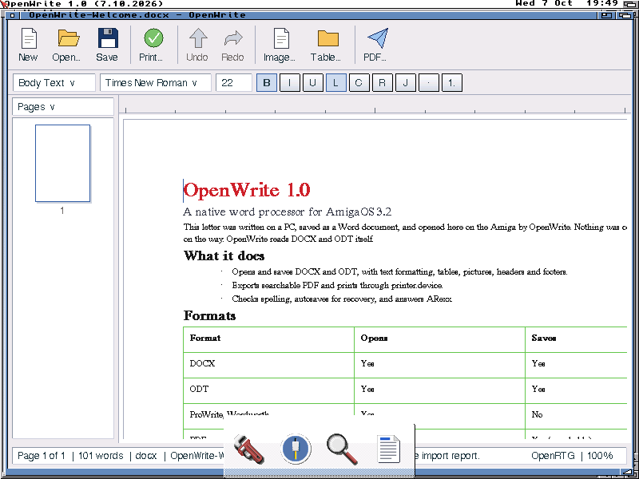

# GFOffice

This is the GFOffice Suite: native office apps for AmigaOS 3.2, all sharing
one document library, **libowf**. Its apps keep their Open names:

- **OpenWrite**, the word processor (released, below);
- **OpenCalc**, the spreadsheet (the formula engine and its core are here; its
  Amiga app is being built);
- **OpenPresentation**, slides; **OpenPublisher**, desktop publishing that
  opens Microsoft Publisher and PageStream files; **OpenBase**, the database
  (all being started).

The suite aims at the features of Apache OpenOffice's apps. It is written from
the file formats' specifications and our own code, never from OpenOffice's
or LibreOffice's. The designs are in `docs/gfoffice/`.

This repository was called `openamigawrite` until 25 October 2026. GitHub
redirects the old name.

# OpenWrite

OpenWrite 1.0.3 is a native word processor for AmigaOS 3.2.



*OpenWrite on AmigaOS 3.2.3 (an AmigaChrome instance with OpenRTG and the Open look), opening a DOCX written in Word.*

It is a small 68040 C application with no FPU requirement and no browser,
Unix GUI or JavaScript runtime dependency. The document/file layer is the
separate C library **libowf**, and **C:OWConvert** converts from the Shell.

OpenWrite 1.0 includes:

- caret/selection editing with bounded grouped undo/redo;
- bold, italic, underline, font family and point size;
- paragraph styles, alignment, indents, spacing and line spacing;
- bullets and numbering;
- native simple tables with row/column editing and Tab/Shift-Tab navigation;
- embedded inline images, decoded for display through Amiga datatypes;
- headers and footers in the document model and rendered pages;
- clipboard.device cut/copy/paste using FTXT-compatible text;
- Find, Find Again, Find Previous, Replace and Replace All;
- automatic pagination and explicit page breaks;
- A4/Letter page setup, portrait/landscape and margins;
- multi-page navigation, scrolling, 100%, Fit Page and Fit Width views;
- spelling against the bundled en_GB dictionary plus a user dictionary;
- 60-second recovery autosave and interrupted-session recovery;
- an ARexx port for scripted open/save/export/print/text/search/edit commands;
- DOCX and ODT formatted import/export, including simple tables and inline images;
- searchable direct PDF export;
- Print: with OpenPrint on the disk, the document as laid out (a PDF, as Export PDF makes it) in OpenPrint's Print window, for an IPP printer or a saved PDF; without OpenPrint, its text through printer.device.

OpenWrite also opens ProWrite, Final Writer/Final Copy-family SWRT documents,
Wordworth, IFF FTXT, ANSI text and plain text. Import reports name
approximations and unsupported material instead of silently pretending it was
preserved.

The current native architecture is documented in
`docs/architecture/NATIVE_CORE.md`; the interaction design is in
`docs/UX_DESIGN.md`; the format matrix is in `docs/FORMATS.md`.

## Open family integration

- **OpenGadTools/OpenLook**: application UI and themes.
- **OpenRTG**: accelerated document-canvas path where available.
- **OpenDatatypes / Amiga datatypes**: embedded image/media decoding.
- **OpenPrint / printer.device**: print and output path.

The same editor remains usable without accelerated RTG hardware; AGA/planar
rendering is a supported fallback path.

## Requirements

OpenWrite:

- AmigaOS 3.2 or later;
- a 68040 (the builds are 68040 code);
- no FPU required;
- small documents are intended to remain usable around 8 MB Fast RAM;
- 16-32 MB Fast RAM is the comfortable target for ordinary work.

OWConvert is 68040 code too and does not require the OpenWrite GUI.

## Building and testing

On Linux, with Python 3 and zlib:

```
make
make core-test
make spell-test
make test
make check
make libc-test
```

`make libc-test` checks owf.library's own printf, strtol and case calls
against the PC's C library. `make test` and `make check` include the
workbook tests (`make book-test`, `make book-check`): Excel 97-2003 files
read into the spreadsheet's model, and saved as CSV
(`tests/book/test_books.py`).
XLSX, ODS, flat ODS and CSV are read and written by the same tests
(`tests/book/test_xml_books.py`, `tests/book/test_bookfmt.c`): files other
programs wrote, packages written by hand from the specifications, round
trips between the formats, and damaged and cut-short files.

They include the formula engine's tests too (`make calc-test`, `make
calc-check`): OpenCalc's engine in `libowf/calc` (calls in
`libowf/include/owf_calc.h`; `docs/CALC_ENGINE.md`), with its functions
checked one by one and against the results saved in the workbook fixtures.

Pages are laid out by OpenLayout (DalsinAI/openamigalayout 0.2 or later).
With it checked out beside this repository, or `OPENLAYOUT_SRC` pointing at
it, `make layout-test` lays out a built document and the samples into pages
and checks the caret and pointer mapping; `make layout-check` runs the same
under the address and undefined-behaviour sanitizers.

For AmigaOS 3.x with the os32-gcc16 stove (OpenAmigaGCC 16; set `OS32_GCC16`
if it is not in `~/AmigaChrome/stoves/os32-gcc16`):

```
./build-os3.sh                 # libowf linked into each program
OWF=library ./build-os3.sh     # both programs on LIBS:owf.library
```

This builds:

```
build/os3/OpenWrite
build/os3/OWConvert
build/os3/library/owf.library      (OWF=library)
build/os3/library/tests/OWFLibTest (OWF=library)
```

ODT and DOCX deflate and inflate through z.library, ours from
amigachrome-guest (`libraries/openzlib`), opened the first time a document
needs it. There is no zlib source in the Amiga build. z.library is no
longer needed to read: without it in LIBS:, libowf inflates zip packages
(ODT, DOCX, XLSX, ODS) with its own inflater, written from RFC 1951
(`libowf/src/owf_inflate.c`, more slowly than z.library; tested by `make
inflate-test` and `make inflate-check`, part of `make test` and `make
check`). Files are then written stored, which every reader accepts.

### owf.library

`owf.library` is libowf as a shared Amiga library: every program that reads
or writes documents (OpenWrite, OWConvert, and the spreadsheet and
presentation programs to come) opens one copy instead of linking its own.
`./build-library.sh [OUT_DIR]` builds it on its own, with no C library: its
memory comes from one Exec pool, and it carries its own string, printf and
number calls (`libowf/library`). The calls are described in
`libowf/library/owf_lib.sfd`; `scripts/gen-sdk.sh` makes its headers in
`libowf/library/sdk` with OpenNDK's ndkgen.

A program uses it by defining `OWF_USE_LIBRARY`, including `owf.h` and
`owf_open.h`, and calling `owf_open()` before anything else. Document memory
a program changes itself comes from `owf_malloc` and `owf_free`, so the
library and the program agree on whose memory it is.

`OWFLibTest SAMPLES=<dir>` on an Amiga checks the library: the formats, a
round trip through ODT, DOCX, HTML, PDF and text in T:, the two sample
documents, and the same checks from a second process at once.

**Version 2** (`owf.library 2.0`) keeps version 1's 29 calls where they were
and adds 58 after them (offsets -204 to -546): the workbooks (`owf.h`'s
"Workbooks" section: XLS, XLSX, ODS, flat ODS and CSV), the formula engine
(`owf_calc.h`), `owf_file_kind` (which program a file is for) and
`owf_struct_size`, zip reading and libowf's own inflate (`owf_zip.h`), and
the .pub reader (`owf_pub.h`). A double goes in two data registers, high
word first. Programs index the library's arrays themselves, so the
structures' sizes are part of its ABI: `owf_open()` opens version 2 and
refuses a library whose sizes differ from the program's. The workbook and
engine code brings doubles into the library, which links no C library:
it carries its own soft double arithmetic (`owf_softdouble.c`, from
amigachrome-guest) and maths and `strtod` (`owf_libm.c`), and opens no
mathieee library, so it needs no FPU and never touches a caller's FPCR.
`make library-test` (part of `make test`) checks them against the PC's,
runs the engine's own tests on them, runs OWFLibTest's version-2 checks
with libowf linked in, and checks the SFD against the headers, the glue's
registers and the SDK (`tests/library/check_sfd.py`). OWFLibTest takes
`FIXTURES=<dir>` too (build-library.sh puts `samples/` and `fixtures/`
beside it). The deck calls (OpenPresentation) come in a later version.

## 1.0 validation

The 1.0 release gate includes:

- native editor/core tests;
- spelling tests;
- AddressSanitizer and UndefinedBehaviorSanitizer runs;
- the libowf normal and sanitizer corruption/cut-short corpus;
- m68k AmigaOS cross-build;
- real AmigaOS 3.2.3/OpenRTG bench validation.

## OpenCalc

OpenCalc is the spreadsheet of the GFOffice Suite, beside OpenWrite in this
repository for now. Its portable core is `src/calc` (`include/opencalc_core.h`):
the view, the selection, keys as Excel and LibreOffice have them, editing,
fill, insert and delete, the clipboard, styles, bounded undo and the grid as a
list of things to draw. It is tested on the PC with `make calc-test` and
`make calc-check` (both part of `make test` and `make check`). The Amiga
window is `app/opencalc.c`, built by `build-os3.sh` with libowf linked in
(OWF=linked). Workbooks are libowf's `owf_book`; their formulas are worked out
by the engine in `libowf/include/owf_calc.h`.

## OpenPresentation

OpenPresentation is the GFOffice Suite's slide program, beside OpenWrite and
OpenCalc here for now (`docs/gfoffice/Design-OpenPresentation.md`). Phase
P1 is in: the deck model in libowf (`libowf/include/owf_deck.h`), ODP and
flat ODP opened and saved, and a deck's PDF, its slides laid out by
OpenLayout in its portable core (`src/deck`, `include/openpresentation_core.h`)
and drawn by the page PDF writer (`libowf/include/owf_pdf.h`).
`OWConvert Talk.odp Talk.pdf` makes one. `make deck-test` and `make
deck-check` (part of `make test` and `make check`) test them; with
OpenLayout found (`OPENLAYOUT_SRC`) the PDF tests run too. Its player and
PPTX come next (P2), then the editor (P3).

## Licence

MIT, Copyright (c) 2026 AmigaChrome Team (`LICENSE`).

Third-party components and data retain their own licences and notices; see
`THIRD_PARTY.md` and `licenses/`.

If you use or build on this work, we ask, but do not require, that you credit
the AmigaChrome Team, for example: "based on OpenWrite by the AmigaChrome
Team".

## Contributors

OpenWrite is created and maintained by
[SacredTrees](https://github.com/SacredTrees), copyright AmigaChrome Team.
Everyone whose work it includes is credited in `CONTRIBUTORS.md`.
