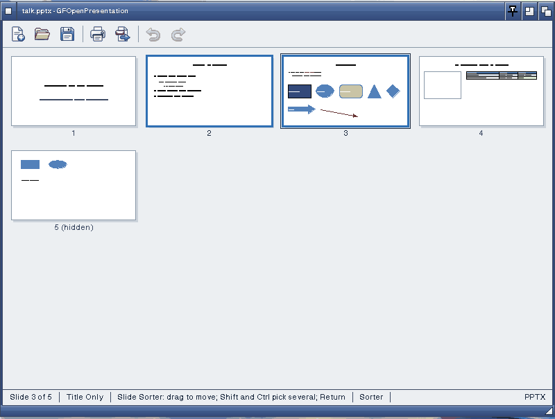

# The GFOffice applications

What each program does and the files it reads and writes. For progress against everyday office work, see [STATUS.md](STATUS.md).

## The suite at a glance

- **Your files, both ways.** OpenDocument and Microsoft Office formats open
  and save: ODT, DOCX, RTF, XLSX, ODS, CSV, ODP and PPTX. Publisher `.pub`
  files open in GFOpenPressmaster, and older Excel `.xls` workbooks open in
  GFOpenCalc.
- **Built for the Amiga.** Real Amiga windows, menus and gadgets, Amiga
  datatypes for pictures, the clipboard in most applications, and an ARexx
  port in every application for scripting and automation.
- **Light on hardware.** A 68040 is enough, no FPU is needed, and small
  documents are happy in 8 MB of Fast RAM. RTG screens are used when they are
  there, and AGA works too.
- **One engine, shared.** Every application sits on libowf, the suite's
  document library, also available as four shared Amiga libraries
  (`owfwrite`, `owfcalc`, `owfpresent` and `owfpub`), so programs share code
  and memory instead of each carrying its own.
- **PDF from every program.** Every application exports PDF, and GFOpenWrite,
  GFOpenCalc, GFOpenPresentation and GFOpenPressmaster also print through
  GFOpenPrint.
- **Clean room and open.** Written from the published file format
  specifications and real sample files, never from another suite's source.
  MIT licensed.

### GFOpenWrite: word processor

A full word processor that keeps up with modern documents: styles, tables,
pictures with text wrap, headers and footers, columns and sections, footnotes,
a linked table of contents, tracked changes and comments, fields, spelling
with an en_GB dictionary, autosave and recovery. Opens and saves DOCX, ODT,
RTF and Markdown, exports HTML and PDF, and opens classic Amiga documents
from ProWrite, Final Writer, Final Copy and Wordworth.

### GFOpenCalc: spreadsheet

A real spreadsheet with a full formula engine: sorting and filtering,
conditional formats with colour scales, data bars and icon sets, validation,
named ranges, Goal Seek, Subtotals, Multiple Operations, Consolidation,
scenarios, pivot tables with drill-down, tracked changes, and live charts with
trendlines, error bars and secondary axes. Opens and saves XLSX, ODS and CSV,
and opens Excel 97-2003 workbooks.

### GFOpenPresentation: slides and slide shows

Build and edit slides with text, pictures, tables, charts and masters, with
solid, gradient and hatched fills and shadows. Rearrange them in the slide
sorter, then present full screen with transitions and timings. Opens and saves
ODP and PPTX.

### GFOpenPressmaster: desktop publishing

Lay out newsletters, flyers and booklets with linked text frames, columns,
text wrap round pictures and shapes, master pages and page numbers, grids and
guides. Mail and catalog merge, built-in templates, and print-ready PDF with
crop marks and bleed. Opens Publisher `.pub` files and saves ODP and PDF.

### GFOpenBase: database

Design tables, keys and relationships, browse and edit in a datasheet, build
queries visually or in SQL, and create forms and grouped, totalled reports
with a print preview. Imports and exports CSV, dBASE, ODS and XLSX, and makes
reports as ODT, DOCX or PDF.

### GFOpenProject: project planner

Plan tasks, milestones and dependencies, see the critical path, and follow the
work in Gantt, Tracking Gantt, Network Diagram and usage views. Assign and
level resources, set baselines, record actuals and track earned value. Reads
and writes Microsoft Project XML and CSV, and reads MPX and GanttProject files.

### GFOpenDiag: diagrams

Flowcharts, UML, network diagrams and mind maps, with connectors that stay
attached, layers, grouping and alignment. It opens and saves `.drawio` files and
exports SVG, PNG, PDF, EPS,
Mermaid, DOT, GraphML and Excalidraw.
