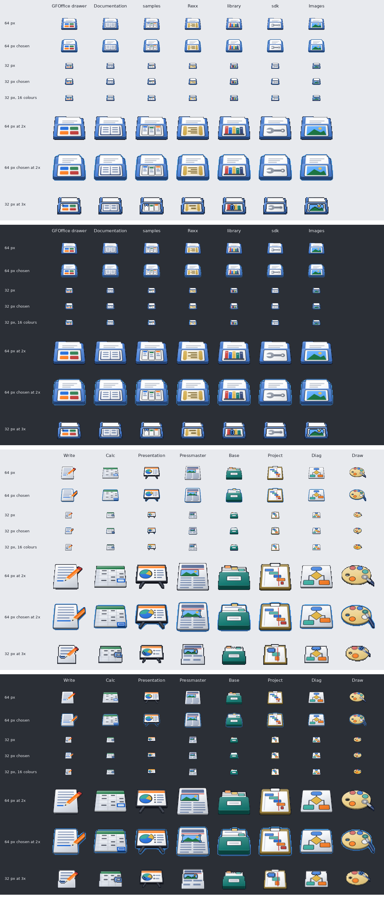

# GFOffice's icons

GFOffice has its own icons for the GFOffice drawer, the drawers inside it and each program. They are drawn in
AmiCradle's Soft 3D style, after the icon guide (amicradle `docs/howto/12-draw-icons.md`, Part 2), so they sit
with the Soft 3D drives and the drawer, project, tool and trashcan icons.

## What there is

| Icon | The picture | Chosen, what moves |
|---|---|---|
| GFOffice (drawer) | The drawer with the suite's four tiles on its front | The papers rise out of the drawer |
| Documentation | The drawer with an open book | The papers rise |
| samples | The drawer with three documents: a letter, a sheet and a slide | The papers rise |
| Rexx | The drawer with a scroll | The papers rise |
| library | The drawer with books on a shelf | The papers rise |
| sdk | The drawer with a spanner | The papers rise |
| Images | The drawer with a picture of a hill under the sun | The papers rise |
| GFOpenWrite | A page of writing and a pencil | The pencil writes on |
| GFOpenCalc | A sheet with a green header and numbers in a grid | The cursor drops to the total, which appears |
| GFOpenPresentation | A slide on its stand with a pie chart | A slice of the pie comes out |
| GFOpenPressmaster | A newsletter page: masthead, picture, two columns | The picture's frame is picked up, its handles showing |
| GFOpenBase | A card file with index cards | One card is pulled up |
| GFOpenProject | A Gantt chart on a clipboard | The last task's bar runs on |
| GFOpenDiag | A flowchart: start, decision, two outcomes | One outcome is dragged and its connector follows |
| GFOpenDraw (and GFOpenDrawOL) | A painter's palette and a brush | The brush moves to another colour and takes it up |

OWConvert is a Shell command and has no icon.

## The files

- `icons/programs/NAME.info` and `icons/drawers/NAME.info`: the icon files. Each is an OS 3.5 GlowIcon with two
  64 x 64 frames (at rest and chosen, up to 255 colours each) and a 4 colour classic picture for OS 3.1. Programs
  are Tool icons; drawers are Drawer icons.
- `icons/png/NAME-64|32-normal|selected.png` and `NAME-32-chipset-*.png`: the pictures, 64 px, the 32 px drawing
  and the 32 px drawing in the shared 16 colour set.
- `icons/sheet.png`: every icon at both sizes, at rest and chosen, blown up, on a light and a dark desktop.

`build-amiga.sh` puts each program's icon beside it, and `samples.info`, `library.info` and `sdk.info` beside
those drawers. The release packer takes `Documentation.info`, `Rexx.info` and `Images.info` from `icons/drawers`
for the drawers it makes, and puts `GFOffice.info` beside the GFOffice drawer, not in it.

## Drawing them again

The drawing code is `tools/icons/gfoffice_icons_art.py`. It needs Python 3 with Pillow and numpy, a gfopenup
checkout (the Soft 3D kit, `tools/soft3d_drives_art.py` and `tools/soft3d_kinds_art.py`) and, for the icon
files, an amicradle-guest checkout (`icons/openicons`):

    python3 tools/icons/gfoffice_icons_art.py --gfopenup ../gfopenup --guest ../amicradle-guest icons
    python3 tools/icons/gfoffice_icons_art.py --gfopenup ../gfopenup --sheet icons/sheet.png

`make icons-test` checks the files with Python's standard library only: every icon is there, 64 and 32 px with
hard edges, the two frames differ, no two icons are alike, the 16 colour pictures keep to 15 colours, and each
`.info` is a 64 x 64 GlowIcon with two frames of the right type.

## Choices the guide leaves open

The guide's Part 3 lists ten choices still Dale's. Until Dale says otherwise these icons take the guide's
default: programs are in Soft 3D, each its own object; 64 x 64 at full size in the icon files, with the 32 px
and 16 colour pictures drawn and kept beside them; chosen, the lift and glow and one thing moves; drawing code
only. Moving to 128 px for programs is one change in `info_bytes()` and `write_all()`: the kit draws 128 from
the same code.
