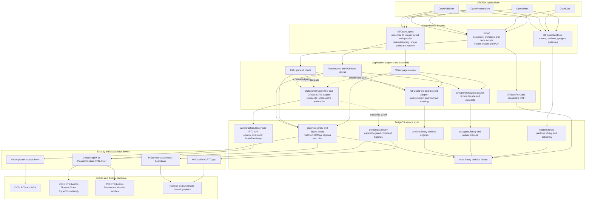

# How GFOpenLayout works in GFOffice

[Download the rendered PNG](openlayout-architecture.png). The editable
Graphviz source is `openlayout-architecture.dot`.

GFOpenLayout owns layout decisions and renderer-neutral geometry. It stores a
node tree, computes pages and boxes using integer units, and emits an immutable
display list. Backends consume that list; they still own platform details such
as pens, fonts, raster images, PDF commands, arrowhead painting and partial
redraw policy.

`ol_shape_path` is the shared boundary for vector shapes. It converts a shape's
normalized points or primitive type into bounded device coordinates and applies
rotation about the box centre without allocation or floating point. The screen
and PDF backends therefore cannot drift into different rectangle, ellipse,
rounded-corner, polygon or rotation implementations.

Writer and the Presentation/Publisher deck adapter use the OpenLayout document
and display-list pipeline. Publisher inherits deck rendering from Presentation.
Calc currently keeps its interactive cell grid and charts in its own viewport
renderer: that is deliberate because OpenLayout does not yet model virtualized
spreadsheet grids, cell selection or chart scenes. The applications' backends,
not OpenLayout, use DataTypes, TextFonts, graphics/layers, CyberGraphX and the
optional GFOpenGPU path. Native planar drawing remains the semantic fallback;
RTG and GPU drivers accelerate the same document geometry when available.

The clean extension points are new size-versioned style fields, appended
display operations, and appended resident-library calls. Likely next shared
additions are curve/path segments, resolved source/destination image geometry,
text/object transforms, and stable display-op-to-node inspection helpers.
